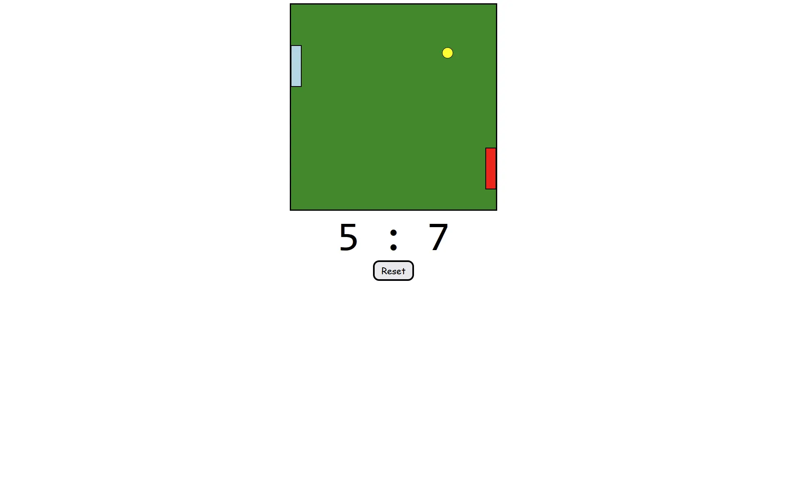

# Pong

A two-player remake of the classic arcade game Pong, built with HTML, CSS, and JavaScript. I made it as a side project between web development courses to practice the fundamentals of game development.

**[Play it live](https://brandsharky.github.io/pong/)**



## Features

- Two-player gameplay with separate keyboard controls for each paddle
- Smooth paddle movement that supports both pressing and holding keys
- Collision detection between the ball, paddles, and walls
- Ball speed that increases progressively as the game continues
- Scoreboard that tracks each player's points
- Reset button to restart the game at any time

## How to Play

Two players share one keyboard. Move your paddle to keep the ball in play and score when your opponent misses. The ball gets faster the longer a round lasts, so stay sharp.

| Player | Move Up | Move Down |
| ------ | ------- | --------- |
| Player 1 | `[w]` | `[s]` |
| Player 2 | `[up-arrow]` | `[down-arrow]` |

## Run It Locally

No installs or build steps are needed.

1. Clone the repository:
   ```bash
   git clone https://github.com/brandsharky/pong.git
   ```
2. Open the project folder.
3. Open `index.html` in your browser.

## Built With

- HTML
- CSS
- JavaScript

## What I Practiced

- Building a game loop
- Collision detection
- Handling keyboard input, including the difference between pressing and holding a key
- Managing game state such as scores and speed
- Tuning difficulty so the speed increase feels fair

## Credits

This project was built by following a YouTube tutorial: **[A game of Pong written in JavaScript](https://www.youtube.com/watch?v=AiFqApeurqI)**. It was my first look at these game development concepts, and I built it to learn from it.

## Author

Brandon Arroyo ([@brandsharky](https://github.com/brandsharky))
